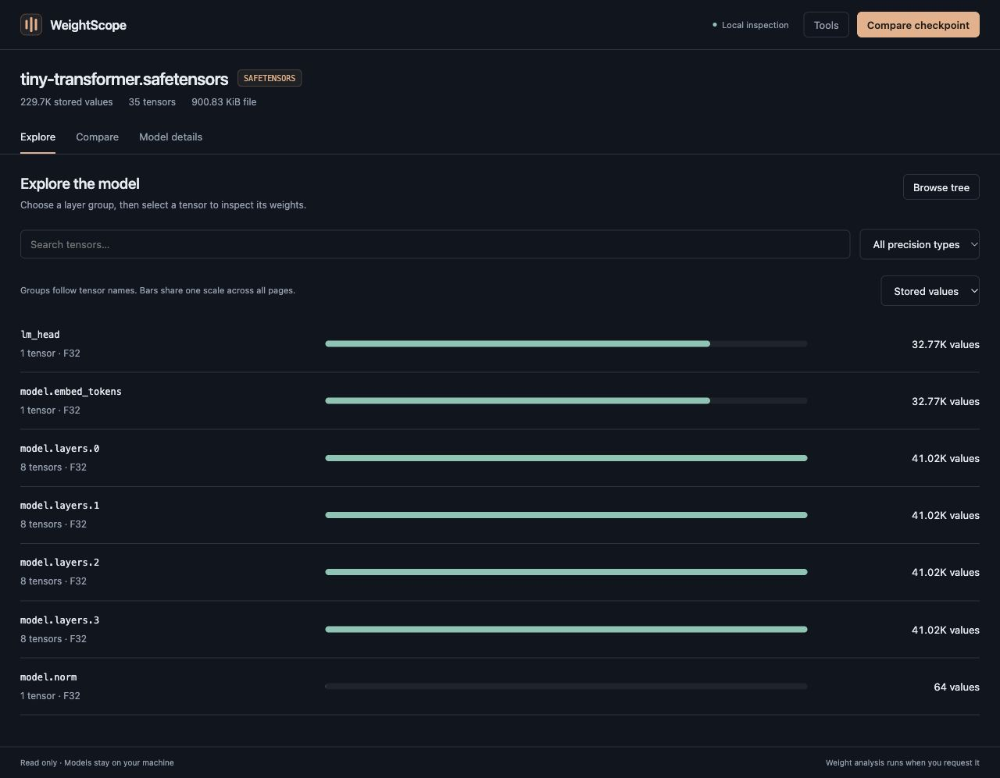
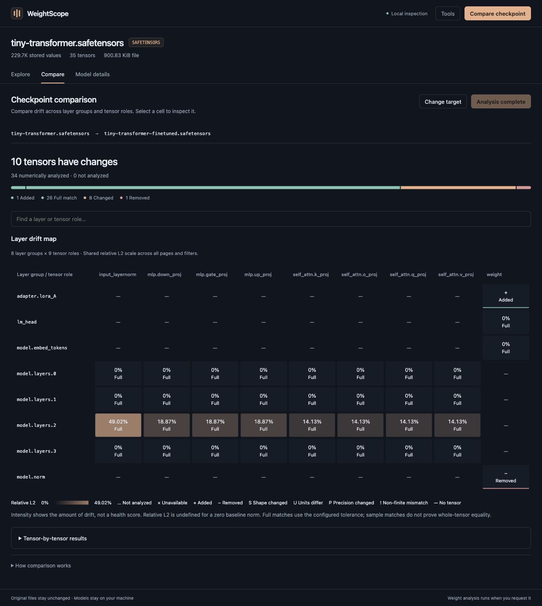

# WeightScope

A local VS Code extension for inspecting model checkpoints and answering **what changed, and are the weights healthy?** Original checkpoints stay unchanged.

Open `.safetensors` (single-file or sharded), `.gguf`, `.onnx`, `.pt`, or `.pth` files, sharded PyTorch `.bin` checkpoints, or select a downloaded Ollama model from its local catalog. Explore a layer tree, shapes, stored parameter counts, dtype distribution, quantization metadata, tensor statistics, and checkpoint differences. Inspection and analysis run on demand. There are no uploads, network requests, or telemetry in the extension.





## Install

1. Clone this repository and run `npm ci`, then `npm run package` (Node.js 22 or newer is required for the packaging tools).
2. In VS Code, run **Extensions: Install from VSIX…** and select the generated `artifacts/weightscope-0.3.1.vsix`.
3. Open a supported model file, or run **WeightScope: Inspect Model**.

If another extension owns these file types, use **Reopen Editor With… → WeightScope**. Requires VS Code 1.90 or newer. Works locally and with Remote SSH when the extension and model are on the remote host.

## A simple first workflow

1. Open a checkpoint. **Explore** shows aligned, clickable layer rows. Switch between **Stored values** and **Storage bytes**; bars share a scale across all pages. Unknown storage sizes remain explicitly unknown.
2. Select a group, then a tensor. Its details open in a focused drawer.
3. Click **Analyze weights** to see a labeled distribution and health check. **Distribution bin counts** exposes the values without hovering; advanced statistics stay under **More statistics & sampling details**.
4. Use **Compare checkpoint** to choose a target, then **Analyze weight changes**. The **Layer drift map** aligns layer groups against actual tensor-name suffixes. Select a cell for its tensor difference, or a row label for all tensors in that group. Search the map and page through groups and roles to inspect large models.

The map colors finite **relative L2 change** (`||target − baseline|| / ||baseline||`) on a shared linear scale across every page and filter. Intensity measures drift, not health. Cells distinguish full and sampled comparisons, uncomputed and unavailable analysis, precision changes, and structural changes; missing cells mean no tensor in that group/role. A zero baseline norm shows **n/a**, not zero drift. If normalized names collide, the cell opens a list of every matching tensor.

The tensor difference drawer overlays baseline bars and a target line with identical bin boundaries and a common vertical scale (percentage of finite analyzed values). It uses the existing bounded samples; no extra weight reads or background scans are needed. NaN/Inf diagnostics remain separate. JSON reports include the histogram bounds and both series.

**Browse tree** opens the tensor name hierarchy. **More columns** reveals exact values and storage bytes. **Tools** contains refresh, JSON export, and Python setup. **Model details** holds full metadata and precision distribution.

## Open sharded Hugging Face checkpoints

Large Hugging Face models ship as `model-00001-of-0000N.safetensors` shards plus a `model.safetensors.index.json` index. Open the index or **any shard**: WeightScope reads every shard's header and presents one checkpoint, with combined totals, layer groups, statistics, and comparisons. Sharded checkpoints compare with each other and with single-file, GGUF, ONNX, PyTorch, and Ollama checkpoints. Only shard headers are read when opening; numerical analysis reads each tensor from its own shard.

Older Hugging Face models ship PyTorch shards instead: `pytorch_model-00001-of-0000N.bin` plus `pytorch_model.bin.index.json`. They open the same way, from the index or any `.bin` shard, and follow the same validation and fallback rules below. Shard metadata and values are read through the PyTorch helper with restricted weights-only loading, so `.bin` shards need a trusted workspace and the [PyTorch setup](docs/PYTORCH.md). The helper runs once per shard when opening, and each analysis reads only the shard that stores the tensor. A standalone `.bin` file that is not a shard (such as a single `pytorch_model.bin`) is not opened. Many repositories ship both layouts in one folder: each shard uses the index of its own format, and the two checkpoints compare tensor by tensor.

The index must sit next to its shards and may only name files of its own format (`.safetensors` or `.bin`) in that folder. Hugging Face cache snapshots (`models--<owner>--<name>/snapshots/<revision>`) work in place, including their symlinked blobs, and are named after the repository. **Model details → Safetensors shards** (or **PyTorch shards**) lists each shard with its tensor count and size, and the tensor inspector names the shard that stores each tensor.

Any index name ending in `.safetensors.index.json` or `.bin.index.json` is supported, such as `diffusion_pytorch_model.safetensors.index.json`. If the index is missing but every shard is present, shards are grouped by file name, with a note. An index that is invalid, names a missing or unreadable shard, or disagrees with the shard contents (a listed tensor is absent, stored in a different shard, or duplicated) is reported as an error when you open the index. Opening one of its shards instead shows that shard alone, with a note that totals and comparisons cover only that file. Tensors stored in shards but missing from the weight map are included, with a note. To view an index as JSON, use **Reopen Editor With… → Text Editor**.

## Open downloaded Ollama models

Run **WeightScope: Open Ollama Model** from the Command Palette (`Cmd+Shift+P` on macOS, `Ctrl+Shift+P` on Windows/Linux), then select a model/tag. The picker reads the local catalog and opens the original weights in place. Ollama does not need to be running, and no rename, copy, download, or model execution is needed.

You can also open a tag file directly under `<store>/manifests/<registry>/<namespace>/<model>/<tag>`, such as `~/.ollama/models/manifests/registry.ollama.ai/library/tev1/4b`. WeightScope resolves this small JSON manifest to its downloaded weight blobs. If the file is already open as JSON, use **Reopen Editor With… → WeightScope**, or select the model with **WeightScope: Open Ollama Model**.

Both GGUF model blobs and newer safetensors tensor blobs are supported. Manifest tensor names are retained, including image model namespaces and shared weight aliases. Local manifest-list references resolve to a downloaded variant, preferring GGUF when available. Model names, tags, registry, prompt template, system prompt, generation parameters, licenses, and small model configurations appear under **Model details → Ollama source & prompt settings**. Additional adapter/projector files are listed separately and excluded from primary weight totals.

The extension uses `weightscope.ollamaModelsPath` if set, then the `OLLAMA_MODELS` environment variable visible to VS Code. Otherwise it searches the default user store (`~/.ollama/models`) and Linux service stores. **Choose Ollama models folder…** in the picker selects a different store for this session; choose the folder containing both `manifests` and `blobs`. Set `weightscope.ollamaModelsPath` to keep that location across restarts. For Remote SSH, the store must be accessible on the extension host. See [Ollama's storage documentation](https://docs.ollama.com/faq#where-are-models-stored).

Run **WeightScope: Compare Ollama Models** to select a baseline and target from the catalog. Inside an inspector, **Tools → Compare Ollama model** or **Compare → Choose Ollama model** compares the current checkpoint with a downloaded model. Regular file checkpoints and Ollama models can be compared with each other.

GGUF numerical analysis uses the supported decoders listed below. Ollama MXFP8 safetensors weights support numerical analysis and checkpoint comparison: four E4M3FN values are unpacked from each U32 word and multiplied by their companion E8M0 scale, shared across 32 weights. Decoded values use float32 rounding, including signed zeros, NaNs, overflow, and underflow. The tensor inspector shows the logical shape and weight count alongside a separate stored-layout disclosure. Model totals, size bars, and tensor tables continue to describe stored entries, including scale codes; they are not unique trainable parameter counts. Other packed schemes (including FP4), missing scales, and incompatible MXFP8 layouts expose metadata with an explicit numerical-decoding explanation. Missing/corrupt downloads, unsupported blobs, and cloud-only entries show explanations. Text/configuration previews are limited to 64 KiB. JSON reports can include local prompts and settings; review them before sharing. Export cannot overwrite the selected manifests or their weight/configuration blobs.

Layer groups follow the first numbered module in tensor names, or the enclosing named module when there is no numbered block. Bars describe stored value counts or storage bytes; they do not infer execution order. Both the optional tree and search retain access to individual tensors.

## What you can do

- Browse the tensor name hierarchy and search all layers, with dtype filtering and paged results.
- See tensor shapes, stored elements, storage bytes, precision distribution, and model metadata.
- Analyze a selected tensor: min, max, mean, population standard deviation, RMS, zero fraction, NaN/Inf counts, and histogram.
- Compare a baseline and target checkpoint by tensor name. Detect added/removed tensors, changed shapes, and changed dtypes immediately.
- Analyze numerical differences for one tensor or a batch: mean absolute delta, maximum absolute delta, RMSE, relative L2, cosine similarity, changed-value count, and non-finite mismatches. The tensor difference drawer and JSON report contain the full metrics.
- Export a JSON report containing metadata, computed statistics, comparison results, coverage, and tolerance.
- View ONNX operators and input/output names.
- Save a validated checkpoint copy under a new name with **Tools → Save checkpoint as…**.

## Save a checkpoint copy

**Tools → Save checkpoint as…** streams a complete copy to a temporary file, validates its tensor structure, and publishes it under a new name. Existing files and aliases are never overwritten. Cancellation and validation failures remove the temporary file. Memory usage stays bounded while copying large models.

Single-file safetensors, GGUF (including downloaded Ollama GGUF blobs), ONNX, and supported PyTorch checkpoints retain their format. PyTorch validation requires the same trusted workspace and interpreter as inspection. ONNX files with external weights must stay in the original directory to preserve relative references; external weights are shared, not copied. Multi-blob Ollama safetensors and sharded safetensors or PyTorch export are not supported; copy the model folder to duplicate a sharded checkpoint.

## Format support

| Format | Metadata / tree | Numerical analysis | Runtime |
| --- | --- | --- | --- |
| safetensors | Single files or Hugging Face shards with an index: shapes, counts, dtypes, metadata, validated ranges | F64/F32/F16/BF16, supported FP8, integers, boolean | Native Node.js, bundled with VS Code |
| Ollama MXFP8 safetensors | Stored U32 layout and logical shape/count, scale reference, block metadata | Sampled dequantized E4M3FN × E8M0 values and cross-format comparisons | Native Node.js; no MLX/Python dependency |
| GGUF | Little-endian v2/v3, tensor metadata, quantization blocks, effective bits per weight | Plain scalar types, Q4_0/Q4_1/Q5_0/Q5_1/Q8_0, Q2_K/Q3_K/Q4_K/Q5_K/Q6_K/Q8_K | Native Node.js |
| ONNX | Initializers, tensor-valued Constant operators, nested graphs, quantization annotations, metadata, operator list | Common scalar raw and typed storage, external weights confined to the model directory | Native streaming protobuf reader; no Python |
| PyTorch `.pt`/`.pth`, sharded `.bin` | Plain tensors/state dicts, common training checkpoint wrappers; Hugging Face `.bin` shards with or without a `.bin.index.json` | Dense real non-quantized tensors, including non-contiguous layouts | Python with PyTorch **>= 2.6**, trusted workspace |

GGUF IQ and newer schemes expose their type, count, block geometry, and byte size. Their numerical decoders are not included in this release. Unknown GGML types and version-dependent Q8_1 block layouts show unknown byte sizes. Big-endian GGUF and version 1 are unsupported.

ONNX quantized integer statistics describe **stored numeric codes**, not dequantized floating-point weights. Comparisons reject mismatched numerical units. Sparse initializers, segmented tensors, string/complex and newer sub-byte types do not have numerical analysis. Sparse initializers are excluded from totals, with a visible warning. ONNX inspection is a focused reader, not a full ONNX validator or inference engine.

PyTorch inspection does not execute forward passes or accept custom pickled modules/TorchScript archives. Quantized PyTorch tensors are not supported by this release's metadata reader; export them as ONNX or GGUF. Setup: [PyTorch instructions](docs/PYTORCH.md).

## Accurate interpretation

The tree follows tensor names; it does not recover the forward-pass graph from a state dict. Counts are **stored tensor elements**, including buffers and aliases, not guaranteed unique trainable parameters.

Opening native-format checkpoints reads bounded metadata and skips weight payloads. Large ONNX messages are scanned without materializing raw weights. GGUF metadata arrays show the first 32 entries while preserving their full count. PyTorch metadata uses FakeTensorMode and weights-only loading; numerical analysis maps modern ZIP checkpoints on CPU. Legacy non-ZIP PyTorch checkpoints up to 512 MiB may require an eager load when analyzing values.

Statistics use up to 32 evenly spaced contiguous windows across flattened row-major indices, bounded by `weightscope.sampleSize`. Small tensors are analyzed in full. Results explicitly say **Full tensor** or **Sampled estimate**; sampled extrema and health checks can miss outliers outside the sample.

Comparisons use identical logical sample positions across formats. **Sample matches** means no differences were found in analyzed positions; it does not prove whole-tensor equality. **Full match** means every value was compared and agreed within tolerance. The JSON status for a full match remains `equal`. Precision changes remain visible even when numerical values match. NaN/Inf pairs are counted separately. Equal NaNs and equal infinities agree for this comparison policy; mismatched non-finite values mark the tensor changed. Relative L2 is undefined for a zero baseline norm, and cosine is undefined for zero norms.

Files changed since inspection must be refreshed before analysis. No background model scans or weight analysis occur.

## Settings

| Setting | Default | Purpose |
| --- | --- | --- |
| `weightscope.pythonPath` | Platform Python | Executable with PyTorch installed; machine-scoped |
| `weightscope.ollamaModelsPath` | Auto-detect | Directory containing Ollama `manifests` and `blobs`; machine-scoped |
| `weightscope.sampleSize` | `32768` | Maximum sampled values per tensor (`256`–`262144`) |
| `weightscope.maxDiffTensors` | `500` | Compatible tensors per batch (`1`–`10000`) |
| `weightscope.absoluteTolerance` | `0` | Absolute numerical difference tolerance |

Use **Analyze next batch** again to continue through large comparisons. Analysis can be cancelled. Reports contain the paths of inspected local files; review them before sharing.

## Develop and verify

The extension has no runtime npm dependencies or build step.

```sh
npm install
npm run check
npm test
npm run demo
npm run preview
npm run package
```

Open this folder in VS Code and press **F5** to start the Extension Development Host. Open one of the generated files in `examples/`, or a shard in `examples/tiny-transformer-sharded/`. The browser preview at `http://127.0.0.1:4173` runs the same frontend against real synthetic safetensors checkpoints. Add `?ollama=1` for the generated Ollama catalog demo, or `?sharded=1` for the same weights as a three-shard checkpoint. File dialogs, the catalog picker, export, and cancellation belong to the VS Code integration.

Framework integration verification is optional and uses an isolated environment:

```sh
python3 -m venv .test-runtime
.test-runtime/bin/python -m pip install 'torch>=2.6' onnx safetensors gguf
WEIGHTSCOPE_TEST_PYTHON="$PWD/.test-runtime/bin/python" npm run test:integration
```

On Windows, use the environment's `Scripts/python.exe`. The test suite covers corrupt/truncated files, sampling semantics, cross-format drift, GGUF decoding, external-data path confinement, file mutation, and framework-written checkpoints. See [product direction](docs/PRODUCT.md).

## References

Parsers follow the upstream [safetensors specification](https://github.com/safetensors/safetensors#format), [GGUF specification](https://github.com/ggml-org/ggml/blob/master/docs/gguf.md), [GGML quantization layouts](https://github.com/ggml-org/ggml/blob/master/src/ggml-common.h), and [ONNX protobuf definitions](https://github.com/onnx/onnx/blob/main/onnx/onnx.proto3). Ollama MXFP8 decoding follows [Ollama's packing and block parameters](https://github.com/ollama/ollama/blob/main/mlx/quant/quant.go), [companion naming and quantization metadata](https://github.com/ollama/ollama/blob/main/create/quantize.go), and the [OCP Microscaling Formats specification](https://www.opencompute.org/documents/ocp-microscaling-formats-mx-v1-0-spec-final-pdf). VS Code integration uses its [Custom Editor API](https://code.visualstudio.com/api/extension-guides/custom-editors).

MIT licensed. The local package uses a placeholder publisher ID; Marketplace publication requires an owned publisher ID and release metadata.
